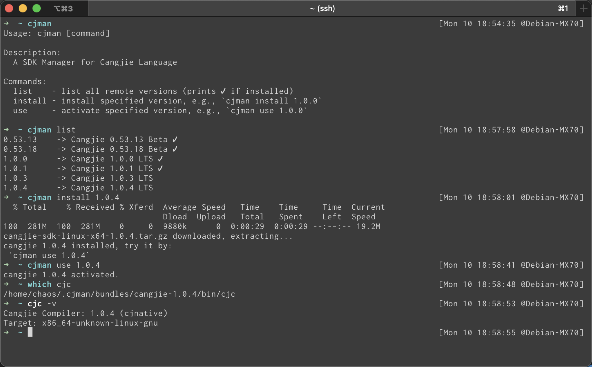

# cjman

`cjman` 是仓颉（Cangjie）SDK 管理器，用来查询、安装和切换官方发布的
LTS、STS 与 Nightly Builds，并为 SDK 下载匹配的 `stdx`。

## 支持范围

- 发布渠道：官网下载中心可达的全部 LTS、STS，以及 GitCode 上的全部
  Nightly 历史构建。
- 宿主平台：Linux、macOS、Windows；Nightly 发布了 OHOS 宿主包时也可安装。
- 宿主架构：`x64`、`aarch64`，以及官方资产中出现的其他组合。
- 编译目标：`native`、`android`、`ohos`、`ios`、`ios-simulator`。
- 目标架构：`x64`、`aarch64`、`arm32`。
- Shell：Bash、zsh、Windows Git Bash/MSYS2/Cygwin，以及 Windows
  PowerShell 5.1/7。

实际可用组合由指定版本发布的官方资产决定。`cjman targets <version>` 会列出
可选组合；请求不存在的组合时会明确报错。Windows 优先使用 ZIP；对于唯一一个
只发布 EXE 的历史 Nightly，`cjman` 会通过 7-Zip 把 NSIS 包解到隔离目录，
不会执行安装器或写系统级环境变量。仅安装该构建时需要预先安装
[7-Zip](https://www.7-zip.org/) 并让 `7z.exe` 可被找到。

## 安装

### Linux、macOS、Windows Git Bash

```bash
bash < <(curl -fsSL https://raw.gitcode.com/ChaosJohn/cjman/raw/master/cjman-installer)
```

安装器默认克隆 GitCode 仓库，并把加载语句写入 Bash 或 zsh 的用户配置文件。
打开新终端即可使用；当前终端可执行：

```bash
source "${HOME}/.cjman/cjman"
```

如需从 GitHub 安装：

```bash
GIT_PROVIDER=github.com bash < <(
  curl -fsSL https://raw.githubusercontent.com/ChaosJohn/cjman/master/cjman-installer
)
```

### Windows PowerShell

```powershell
$installer = Join-Path $env:TEMP 'cjman-installer.ps1'
irm https://raw.gitcode.com/ChaosJohn/cjman/raw/master/cjman-installer.ps1 -OutFile $installer
& $installer
```

安装器会更新当前用户的 PowerShell profile，但不会更改执行策略。打开新的
PowerShell 窗口即可使用；当前窗口可执行：

```powershell
. "$HOME\.cjman\cjman.ps1"
```

## 使用

```text
cjman list [--nightly]
cjman targets <version>
cjman install <version> [options]
cjman install-stdx <version> [options]
cjman use <version> [options]
cjman update
```

版本既可以写完整版本号或 Nightly tag，也可以使用以下别名：

- `latest`：最新正式版。
- `lts`：最新 LTS。
- `sts`：最新 STS。
- `nightly`：最新 Nightly Build。

常用示例：

```bash
# 查询正式版、全部 Nightly，以及某个版本的发布组合
cjman list
cjman list --nightly
cjman targets 1.1.3
cjman targets nightly

# 安装原生 SDK 和匹配的 stdx
cjman install lts

# 安装交叉编译 SDK
cjman install 1.1.3 --target ohos --target-arch aarch64
cjman install nightly --target android --target-arch arm32

# 只安装 SDK，或稍后补装 stdx
cjman install sts --without-stdx
cjman install-stdx sts

# 在当前 Shell 中切换版本
cjman use lts
cjman use 1.1.3 --target ohos --target-arch aarch64
```

安装与切换选项：

```text
--target <name>       native（默认）、android、ohos、ios、ios-simulator
--target-arch <arch>  x64、aarch64、arm32；交叉目标默认 aarch64
--host-arch <arch>    覆盖自动探测的宿主架构
--without-stdx        仅用于 install，不下载 stdx
```

不同宿主、目标和目标架构会安装到相互隔离的目录，不会互相覆盖。
旧版 `cjman` 已安装在 `cangjie-<version>` 目录中的原生 SDK 仍可继续
`use` 或补装 `stdx`；新安装会采用包含宿主与目标身份的隔离目录。

## stdx 版本规则

正式版 SDK 的 `stdx` 来自
[Cangjie/cangjie_stdx releases](https://gitcode.com/Cangjie/cangjie_stdx/releases)。
`cjman` 按资产文件名严格匹配 SDK 版本，并把末尾修订号按数字比较后选择最高值。
例如同时存在 `1.0.1.1`、`1.0.1.2` 和 `1.0.1.10` 时，会选择
`1.0.1.10`，不会按字符串顺序误选。

Nightly 的 SDK、frontend 与 `stdx` 从同一个 Nightly release 枚举，不根据
tag 猜测文件名，因此历史构建中 tag 与资产版本串不完全一致时仍可安装。

如果某个 SDK/目标没有发布匹配的 `stdx`，普通 `install` 会给出警告并保留已
安装的 SDK；显式执行 `install-stdx` 则会失败并说明缺少的目标组合。安装完成后：

- `stdx` 位于对应 SDK 目录下的 `stdx/`。
- `cjman use` 会设置 `CJMAN_STDX_ROOT`，便于在 `cjpm.toml` 中引用实际的
  `dynamic/stdx` 或 `static/stdx` 子目录。

## 数据来源与可靠性

- LTS/STS 使用仓库中的 `metadata/v2/catalog.tsv` 与逐版本 TSV 清单，记录
  官方 URL、平台、架构、目标、格式和 SHA-256。
- Nightly 与 `stdx` 通过 GitCode release API 动态枚举资产。
- 正式版 SDK 下载后校验 SHA-256。
- 下载先写入临时文件，解压先进入 staging 目录，成功后再原子移动到最终目录。
- ZIP/TAR 条目会在解压前检查绝对路径与目录穿越。
- EXE-only Nightly 会先经 7-Zip 完整性与路径检查，再作为 NSIS 归档解包；
  不会提权运行其安装向导。

## 维护正式版元数据

新增 LTS/STS 时，只维护 `metadata/v2`；运行时不再读取遗留的
`versions.txt` 或 `versions/`。仓库提供一个 Node.js 18.1+、无 npm 依赖的
生成器。它从官网下载页发现当前带 hash 的版本 bundle，提取 SDK URL、平台、
架构、目标、SHA-256 和大小，并在全部校验通过后更新 catalog 与逐版本 TSV。

先预览，再写入：

```bash
node ./scripts/update-formal-release.mjs update <version> --dry-run
node ./scripts/update-formal-release.mjs update <version>
node ./scripts/update-formal-release.mjs validate
```

可用 `--expect-channel LTS` 或 `--expect-channel STS` 断言官网渠道。已有版本
与官网内容不同时，生成器默认拒绝覆盖；检查 dry-run 后显式传
`--replace`。工具按自身路径定位当前 checkout 的 `metadata/v2`，所以从其他
目录用脚本绝对路径执行也可以：

```bash
repo_root="$(git rev-parse --show-toplevel)"
node "$repo_root/scripts/update-formal-release.mjs" update <version> --dry-run
```

如果网络不可用，但已有官网下载页引用的原始 `version.<hash>.js`，可使用
`--bundle-file <path>`。官网结构改变或自动解析失败时，使用本地
`cjman-formal-release-metadata` Skill 中的人工浏览器回退流程；不能猜测 URL、
架构或 SHA。

正式版 TSV 只记录 SDK。正式版 `stdx`、Nightly SDK/frontend/stdx 继续在运行
时通过 GitCode release API 动态解析，因此新增正式版时不维护对应的 stdx TSV。

开发者可运行离线契约测试：

```bash
bash tests/run.sh
```

```powershell
pwsh -NoProfile -File .\tests\run.ps1
# Windows PowerShell 5.1 也可使用：
powershell -NoProfile -File .\tests\run.ps1
```

## 灵感来源

- [nvm-sh/nvm](https://github.com/nvm-sh/nvm)
- [moovweb/gvm](https://github.com/moovweb/gvm)
- [pyenv/pyenv](https://github.com/pyenv/pyenv)
- [sdkman/sdkman-cli](https://github.com/sdkman/sdkman-cli)


